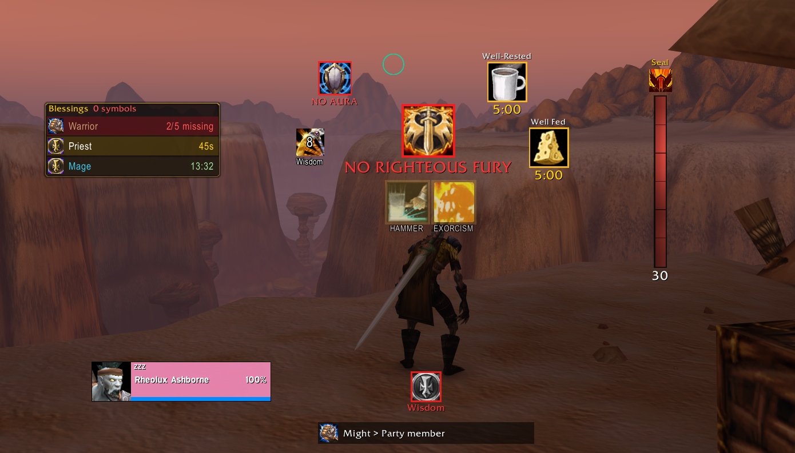
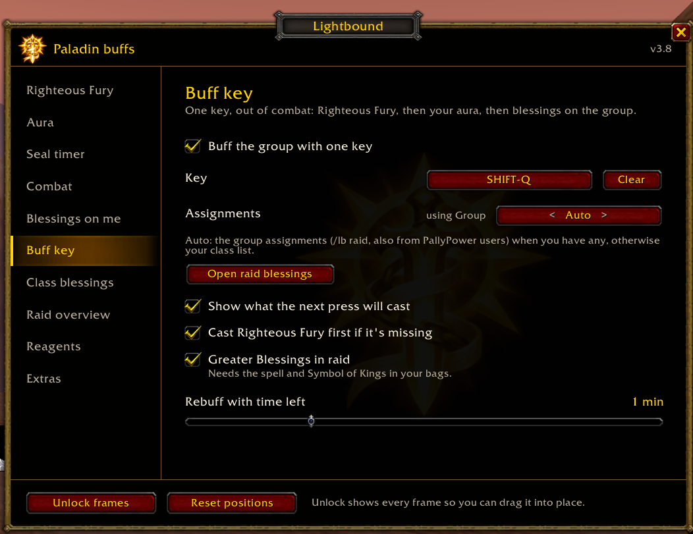
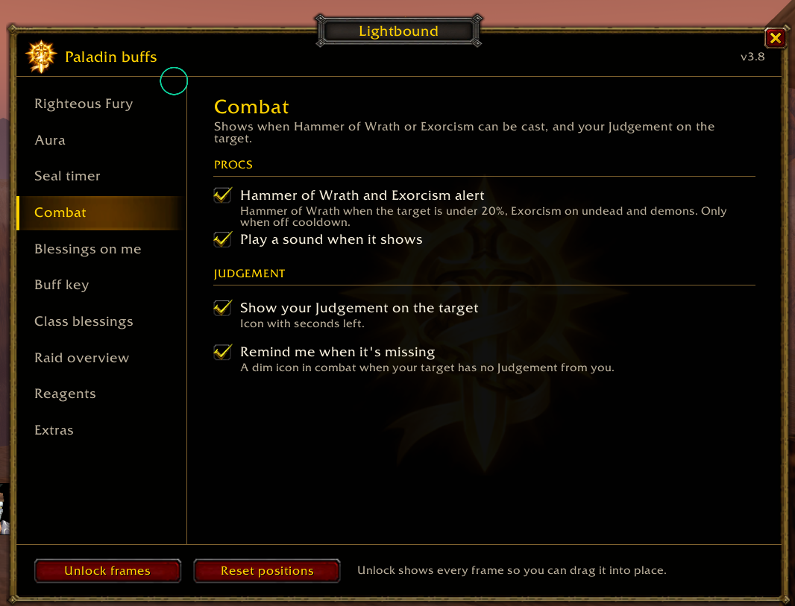

# Lightbound

An all-in-one paladin addon for **World of Warcraft: Forever** (interface 16001). It buffs your party and raid with a single key, sorts out who blesses which class with the other paladins, and reminds you about everything a paladin forgets.

Lightbound replaces PallyPower and speaks PallyPower's addon-message format (`PLPWR`). Paladins who still run PallyPower see you, can assign you, and receive your assignments.

> **Status:** early. Built and used on Forever. Raid sync with PallyPower users hasn't been tested much yet, so please report issues.

## Screenshots

  

  

  
  

More in [screenshots/](screenshots).

## Features

**Buffing**
- **One buff key.** Out of combat, each press casts the next thing needed: Righteous Fury, then your aura, then the assigned blessing on the next party or raid member who is missing it or about to lose it.
  - Greater Blessings are used in raids when you have Symbol of Kings.
  - It checks range and refreshes blessings before they run out.
- **Raid blessings window (`/lb raid`).** A grid of paladins against classes, plus aura and cooldowns.
  - Click a cell to change the blessing, or shift-click it to set blessings for individual players.
  - Auto-assign, Clear and Refresh.
  - The leader and assists can edit every row. Everyone else can edit their own row, or anyone who opts in.
  - Shows Lay on Hands and Divine Intervention cooldowns, Symbol of Kings counts, and Improved Might/Wisdom talents, which auto-assign takes into account.
- **Raid overview.** One row per class you bless, showing how many are missing it and the shortest time left. Click a row to bless that class.
- **Own class choices.** A blessing per class for when you're not in a raid.

**Warnings and trackers**
- Righteous Fury missing while grouped (party, raid, open world)
- Aura missing, or the wrong aura
- Seal timer bar
- Blessings on yourself, with time left
- Hammer of Wrath (target below 20%) and Exorcism (undead/demon) alerts
- Your Judgement on the target, plus a reminder when it's missing in combat
- Trackers row: Reckoning stacks (gold at 4), Consecration countdown, Holy Shock cooldown, and a Judgement of Wisdom reminder when your mana runs low
- Well-Rested and Well Fed: a warning before they run out, and when Well Fed is gone
- Cleanse list: group members (and pets) with a Poison, Disease or Magic debuff you can remove, one click per row, with a sound and an ignore list. Rows keep their targets while you're in combat

**Quality of life**
- Buys Symbol of Kings and Symbol of Divinity automatically at vendors, and warns when you run low
- Minimap button and addon compartment entry
- Every frame can be moved (Unlock frames)

## Install

1. Download the repository (Code → Download ZIP) or clone it.
2. Put the folder in `World of Warcraft/_forever_/Interface/AddOns/` and make sure it is named **`Lightbound`**.
3. Restart the game, not just `/reload`, so the new textures load.
4. If you're replacing PallyPower: log in once with PallyPower still enabled. Lightbound copies your assignments and stays quiet while PallyPower is loaded. Then disable PallyPower.

## Commands

| Command | What it does |
| --- | --- |
| `/lb` | Options window |
| `/lb raid` | Raid blessings window |
| `/lb why` | Explains the buff key's choice for every group member |
| `/lb move` / `/lb reset` | Unlock frames / reset positions |
| `/lb ignore <debuff>` | Add or remove a debuff from the cleanse list's ignore list; `/lb ignore` shows it |
| `/lb minimap`, `/lb fed`, `/lb rested`, `/lb rfraid` | Toggle the minimap button, the Well Fed warning, the Well-Rested warning, or Righteous Fury warnings in raids |

The buff key is set under **Buff key** in `/lb`.

## Notes

- Built for the Forever client: it handles values the client hides in combat and uses secure buttons, so casting only happens out of combat.
- Settings are saved per account in `LightboundDB`.

## License

MIT, see [LICENSE](LICENSE).
